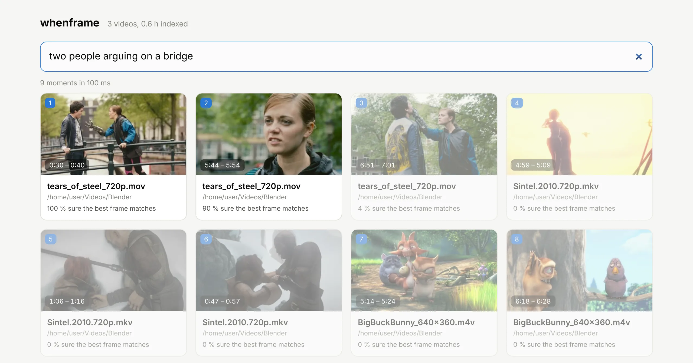

# whenframe


Find a moment in your own videos by describing it. whenframe indexes a folder
of videos on your computer, with no GPU and nothing sent anywhere, and answers
"the dog jumps into the pool" with the video and the seconds where it happens.

**[Try it in your browser](https://qthullie.github.io/whenframe/)** on three open movies, or install it below.

<p align="center">
  <picture>
    <source media="(prefers-color-scheme: dark)" srcset="docs/figures/demo-1-dark.webp">
    
  </picture>
  <br>
  <sub><code>whenframe serve</code> on three Blender open movies: Big Buck Bunny, Sintel and Tears of Steel (© Blender Foundation, CC BY 3.0).</sub>
</p>

<!-- table readme-headline -->
Searching 979 personal videos at once (DiDeMo test) for 3,902 descriptions written by people, whenframe puts the right moment among its first five results **27.2 %** of the time. Indexing one keyframe per shot, as some home video tools do, finds it 2.3 % of the time, and the best of the two baselines (fixed windows) 25.0 %.
<!-- /table -->

## Use

```bash
pip install git+https://github.com/qthullie/whenframe   # Python 3.10+, and ffmpeg on the PATH
whenframe index ~/Videos                                # once, then again to add new videos
whenframe search "the dog jumps into the pool"
whenframe serve                                         # the page above, at http://127.0.0.1:8765
```

```
 83%     1:12 - 1:22      /home/me/Videos/2024/summer/IMG_4120.MOV
 71%     0:03 - 0:13      /home/me/Videos/2023/garden.mp4
```

The first run downloads the SigLIP 2 model (1.5 GB). A library is indexed in
one of three modes, chosen the first time (`--mode`):

<!-- table readme-modes -->
| `--mode` | right moment in the first five (DiDeMo) | indexing, CPU min per hour of video | search (ms) |
|---|---|---|---|
| `standard` | 27.2 % | 24.9 | 63 |
| `economy` | 24.5 % | 8.4 | 61 |
| `precision` | 27.2 % | 33.2 | 123 |
<!-- /table -->

Nothing else goes over the network. ONNX Runtime 1.29 sends usage telemetry to
Microsoft by default; whenframe sets `ORT_DISABLE_TELEMETRY=1` before loading
it (checked by logging every outbound connection of an indexing and search run).
More in [docs/TUTORIAL.md](docs/TUTORIAL.md).

## How it works

1. ffmpeg reads one frame per second; frames that barely differ from the last
   one kept are skipped.
2. [SigLIP 2](https://arxiv.org/abs/2502.14786) embeds the frames and the
   description (ONNX Runtime, CPU). Its sigmoid gives each frame an absolute
   match score, so frames from different videos compare directly.
3. Frames that match almost any description are marked down, using a bank of
   4,096 unrelated descriptions: query-bank normalisation
   ([Bogolin et al., CVPR 2022](https://arxiv.org/abs/2112.12777)), applied to
   video frames.
4. In each of the best videos, up to three 10-second moments are placed around
   the best frames, and all moments are ranked together. In precision mode the
   scores of two models are standardised and added first.

## Results

DiDeMo test split, with the protocol fixed in advance and every change to it
listed ([docs/PROTOCOL.md](docs/PROTOCOL.md)). The numbers on this page are
written by `scripts/tables.py` from `results/*.json`.

<p align="center">
  <picture>
    <source media="(prefers-color-scheme: dark)" srcset="docs/figures/results-dark.png">
    
  </picture>
</p>

<!-- table didemo-criteria -->
| criterion (fixed in advance) | measured on test | met |
|---|---|---|
| 1. adaptive spans beat both baselines by at least 2 points | -1.8 points | no |
| 2. skipping repeats encodes at most 70 % of frames and loses at most 1 point | 91 % of frames, +0.2 points | no |
| 3. indexing takes at most 10 min of CPU time per hour of video | 24.9 min | no |
| 4. the query bank adds at least 1 point to adaptive spans | +1.6 points | yes |
| 5. the query bank adds at least 1 point to fixed windows | +2.2 points | yes |
<!-- /table -->

Second round (two more modes, French descriptions):

<!-- table round2-criteria -->
| criterion (fixed before the second run) | measured on test | met |
|---|---|---|
| 6. the economy mode loses at most 2 points | -2.7 points | no |
| 7. economy indexing takes at most 10 min of CPU time per hour of video | 8.4 min | yes |
| 8. the precision mode gains at least 1 point | +0.1 points | no |
<!-- /table -->

All tables, the costs and the figures: [docs/RESULTS.md](docs/RESULTS.md).

## Limits

- It sees frames, not motion or sound: "the camera pans left" or "someone
  laughs" are out of its reach.
- It was measured on the first 30 seconds of short personal videos (DiDeMo);
  long videos were not measured.
- Indexing is slow on a small machine (see the modes above, measured on 4 vCPUs).
- Descriptions in French were measured through machine translation only.
- Several criteria set in advance were not met; the results page says which and
  why.

## Documents

- [docs/RESEARCH.md](docs/RESEARCH.md): what already exists, and what is new here
- [docs/PROTOCOL.md](docs/PROTOCOL.md): the evaluation, written before each test run, and every change made to it
- [docs/RESULTS.md](docs/RESULTS.md): all the numbers
- [docs/TUTORIAL.md](docs/TUTORIAL.md): installing, indexing, searching, the page, reproducing the benchmark

## Credits

- DiDeMo: Hendricks et al., *Localizing Moments in Video with Natural
  Language*, ICCV 2017. Charades-STA: Gao et al., *TALL*, ICCV 2017, on
  Charades: Sigurdsson et al., ECCV 2016.
- SigLIP 2: Tschannen et al., 2025. The weights, downloaded at the first run,
  are Google's, under the Apache 2.0 licence.
- The query bank holds embeddings of DiDeMo training descriptions (BSD 2-Clause);
  see [whenframe/data/NOTICE](whenframe/data/NOTICE).
- The benchmark also measures MobileCLIP-S2 (Apple, research-only licence) and
  translates descriptions with Opus-MT (Helsinki-NLP, Apache 2.0); the tool uses
  neither.
- The demo uses Big Buck Bunny, Sintel and Tears of Steel, © Blender Foundation,
  CC BY 3.0.

## Licence

MIT.
