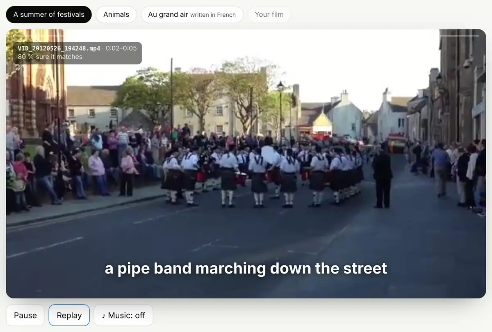

<p align="center">
  
</p>

<h1 align="center">whenframe</h1>

<p align="center">
  <b>Describe a moment, find it in your videos. Write a story, get the film.</b><br>
  whenframe's own model runs on your computer: no GPU, nothing sent anywhere.<br>
  <a href="https://qthullie.github.io/whenframe/"><b>Watch it cut a film in your browser</b></a>
</p>

<p align="center">
  <a href="https://qthullie.github.io/whenframe/">
    <picture>
      <source media="(prefers-color-scheme: dark)" srcset="https://raw.githubusercontent.com/qthullie/whenframe/main/docs/figures/site-dark.webp">
      
    </picture>
  </a>
  <br>
  <sub>Real videos and photos, shared on Flickr under CC BY 2.0 (YFCC100M; <a href="https://qthullie.github.io/whenframe/credits.html">credits</a>), cut into a film in the browser.</sub>
</p>

```bash
pip install git+https://github.com/qthullie/whenframe   # Python 3.10+ and ffmpeg
whenframe index ~/Videos
whenframe search "the dog jumps into the pool"
whenframe search "le chien saute dans la piscine"   # French is translated on your computer
whenframe film story.txt -o film.mp4                # one shot per sentence, cut at the right second
whenframe supercut "fireworks" -o fireworks.mp4     # every moment of it, in the order they were filmed
```

## The model

whenframe searches with a model of its own: two image encoders that see
differently (Google's SigLIP 2 and Meta's Perception Encoder), each frame
rewritten by whenframe's own models with what the frames around it show,
frames that match any text marked down, both encoders' scores added. It finds
the file, and the seconds where the moment happens, which is what lets
`whenframe film` cut a film from a few sentences.

<!-- table readme-compare -->
|  | whenframe, on a CPU | others |
|---|---|---|
| **Find the video** among 979 (DiDeMo, in the first 5) | **51.1 %** | 25.4 % EventFormer (2024), trained on DiDeMo, on a GPU · 30.7 % one image per video |
| **Find the moment** among 979 videos (DiDeMo, in the first 5) | **32.0 %** | 2.3 % one keyframe per shot, as home video tools index |
| **Place the moment** in a given video, never trained on it (Charades-STA, first answer) | **49.9 %** | 43.7 % VTG-GPT · 50.0 % TFVTG · 56.8 % a 7B vision-language model |
<!-- /table -->

Every number, how it was measured, and the protocol written before each test:
[results](https://github.com/qthullie/whenframe/blob/main/docs/RESULTS.md) ·
[protocol](https://github.com/qthullie/whenframe/blob/main/docs/PROTOCOL.md) ·
[tutorial](https://github.com/qthullie/whenframe/blob/main/docs/TUTORIAL.md).

MIT licence. The weights of whenframe's own models are for research and
non-commercial use ([credits](https://github.com/qthullie/whenframe/blob/main/docs/CREDITS.md)).
