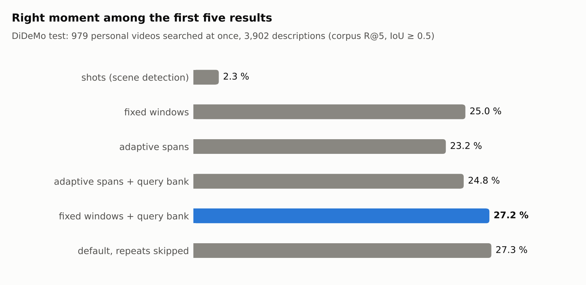
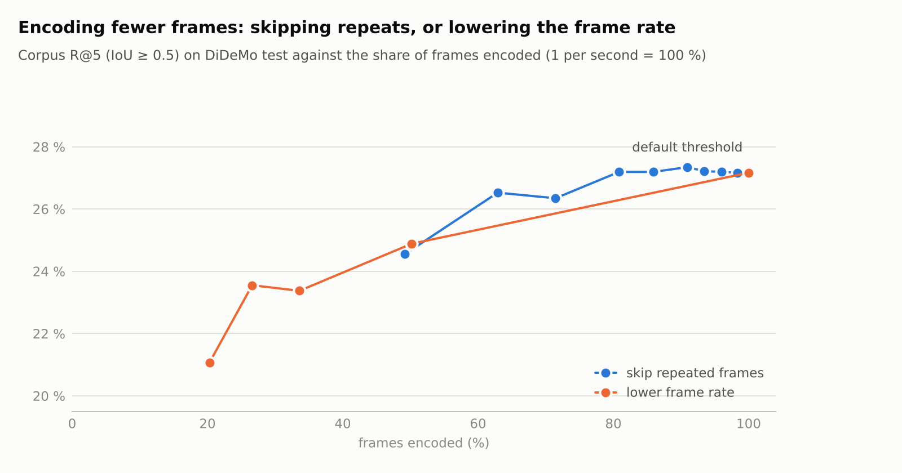
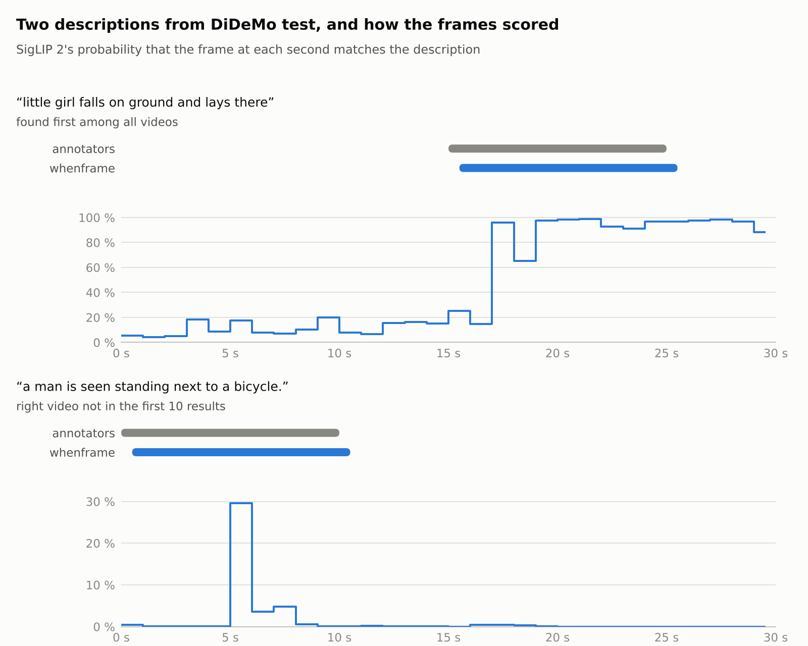

# Results

DiDeMo test split, under the protocol in [PROTOCOL.md](PROTOCOL.md). 979 of the
1,004 test videos could be downloaded, with 3,902 of the 4,021 descriptions;
the first 30 seconds of each video are searched, as the annotators saw them.
Every parameter was chosen on 500 training videos (1,957 descriptions), and
the test split was evaluated once, after changes 1 to 10 of the protocol had
been committed.

The tables between `<!-- table -->` markers are written by `scripts/tables.py`
from `results/didemo_test.json`; CI fails if they differ from that file.

## Criteria

<!-- table didemo-criteria -->
| criterion (fixed in advance) | measured on test | met |
|---|---|---|
| 1. adaptive spans beat both baselines by at least 2 points | -1.8 points | no |
| 2. skipping repeats encodes at most 70 % of frames and loses at most 1 point | 91 % of frames, +0.2 points | no |
| 3. indexing takes at most 10 min of CPU time per hour of video | 24.9 min | no |
| 4. the query bank adds at least 1 point to adaptive spans | +1.6 points | yes |
| 5. the query bank adds at least 1 point to fixed windows | +2.2 points | yes |
<!-- /table -->

Three of the five criteria fixed in advance are not met.

- **1.** Adaptive spans, the moment-placing method whenframe was first built
  around, trail fixed windows at IoU >= 0.5. The next section shows why this
  says more about DiDeMo's moments than about spans.
- **2.** At its default threshold the repeat filter keeps 91 % of DiDeMo's
  frames, far from the 70 % hoped for. It costs nothing in accuracy.
- **3.** Indexing takes 24.9 minutes of CPU time per hour of video, two and a
  half times the target. On this 4-vCPU machine that is 7.4 minutes of waiting
  per hour of video.
- **4 and 5.** The query bank adds 1.6 points to adaptive spans and 2.2 points
  to fixed windows. The default search is fixed windows with the query bank.

With 3,902 descriptions, a recall near 27 % has a standard error of about
0.7 points, so differences of about one point between methods are within noise.

## Finding the moment in the whole library

Every description is searched against all the test videos at once. R@k: one of
the first k moments returned is in the right video and overlaps the annotated
moment with IoU >= 0.5 (or 0.7 where noted).

  <picture>
    <source media="(prefers-color-scheme: dark)" srcset="figures/results-dark.png">
    
  </picture>

<!-- table didemo-corpus -->
| method | R@1 | R@5 | R@10 | R@100 | R@1 (0.7) | R@5 (0.7) | right video in top 5 |
|---|---|---|---|---|---|---|---|
| shots (scene detection) | 1.3 | 2.3 | 2.8 | 4.6 | 0.4 | 0.5 | 30.3 |
| fixed windows | 11.7 | 25.0 | 31.7 | 52.9 | 2.9 | 5.0 | 42.3 |
| adaptive spans | 11.3 | 23.2 | 30.1 | 50.5 | 4.5 | 8.4 | 42.3 |
| adaptive spans + query bank | 12.2 | 24.8 | 31.3 | 51.8 | 4.8 | 9.4 | 45.8 |
| **fixed windows + query bank** (default) | 13.1 | 27.2 | 34.0 | 54.8 | 2.9 | 5.7 | 46.4 |
| default search, repeats skipped | 13.2 | 27.3 | 34.2 | 54.9 | 2.9 | 5.8 | 46.4 |
<!-- /table -->

**Frames, not shots.** 87 % of DiDeMo's videos have no cut in their first 30
seconds (measured on the tuning videos), so a shot is usually the whole clip,
and a whole clip almost never overlaps a 5-second moment with IoU >= 0.5.
Scoring every frame finds the right moment twelve times as often as scoring one
keyframe per shot. It also finds the right video more often: in the first five
for 46.4 % of descriptions, against 30.3 %.

**The query bank.** It adds about two points whatever places the moments, and
it does so by ranking the right video higher (in the first five: 42.3 % without
the bank, 46.4 % with it). The frames it marks down are the ones that match
almost any description, as in cross-modal retrieval.

**Fixed windows or adaptive spans.** 77 % of the reference moments are one
5-second segment. A 10-second window that contains such a segment has an IoU
of exactly 0.5: enough for the primary metric, never enough for 0.7. The
primary metric therefore rewards 10-second windows on this dataset, and the
tuning found them. At IoU >= 0.7 the order flips: adaptive spans find the
right moment in the first five 8.4 % of the time (9.4 % with the bank), fixed
windows 5.0 % (5.7 %). Spans are the more precise of the two when they are
right; the tool offers them as `SearchConfig(moments="spans")`.

## Placing the moment when the video is given

<!-- table didemo-single -->
| method | R1 IoU>=0.5 | R1 IoU>=0.7 | mean IoU |
|---|---|---|---|
| shots (scene detection) | 5.3 | 0.9 | 21.4 |
| fixed windows | 46.8 | 9.5 | 33.5 |
| adaptive spans | 44.4 | 15.8 | 35.0 |
| adaptive spans + query bank | 44.6 | 16.3 | 35.5 |
| **fixed windows + query bank** (default) | 46.7 | 9.7 | 33.8 |
| default search, repeats skipped | 46.9 | 9.8 | 33.9 |
<!-- /table -->

The same pattern inside one video: fixed windows are right more often at
IoU >= 0.5, adaptive spans at IoU >= 0.7. Shots are almost never right.

## Cost

<!-- table didemo-cost -->
| per hour of video | CPU time (min) | wall clock, 4 vCPU (min) |
|---|---|---|
| decoding (ffmpeg, 1 frame per second) | 2.3 | 1.1 |
| encoding every frame | 22.6 | 6.3 |
| encoding, repeats skipped (91 % of frames, estimated) | 20.6 | 5.7 |
| scene detection (needed by the scene baseline only) | 2.2 | 1.1 |
<!-- /table -->

<!-- table didemo-search -->
|  | value |
|---|---|
| videos / queries / hours of video | 979 / 3902 / 7.90 |
| index size, every frame (MB per hour of video) | 5.5 |
| embedding the query (ms) | 45 |
| search, shots (scene detection) (ms per query) | 2.2 |
| search, fixed windows (ms per query) | 4.3 |
| search, adaptive spans (ms per query) | 5.5 |
| search, adaptive spans + query bank (ms per query) | 5.4 |
| search, fixed windows + query bank (ms per query) | 5.0 |
| search, default search, repeats skipped (ms per query) | 4.9 |
<!-- /table -->

Encoding the frames is 22.6 of the 24.9 CPU minutes per hour of video. On this
machine one frame takes about 0.38 s of CPU time with ONNX Runtime; other
processors were not measured. A search embeds the query (45 ms) and scores the
whole library (about 5 ms for these 7.9 hours of video); the second part grows
with the size of the library.

## Encoding fewer frames

  <picture>
    <source media="(prefers-color-scheme: dark)" srcset="figures/cost-dark.png">
    
  </picture>

<!-- table didemo-curve -->
| frames encoded | share | R@5 IoU>=0.5 |
|---|---|---|
| skip repeats, threshold 0 | 100 % | 27.2 |
| skip repeats, threshold 1 | 98 % | 27.2 |
| skip repeats, threshold 2 | 96 % | 27.2 |
| skip repeats, threshold 3 | 93 % | 27.2 |
| skip repeats, threshold 4 | 91 % | 27.3 |
| skip repeats, threshold 6 | 86 % | 27.2 |
| skip repeats, threshold 8 | 81 % | 27.2 |
| skip repeats, threshold 12 | 71 % | 26.3 |
| skip repeats, threshold 16 | 63 % | 26.5 |
| skip repeats, threshold 24 | 49 % | 24.6 |
| every frame | 100 % | 27.2 |
| one frame in 2 | 50 % | 24.9 |
| one frame in 3 | 34 % | 23.4 |
| one frame in 4 | 27 % | 23.6 |
| one frame in 5 | 20 % | 21.1 |
<!-- /table -->

Skipping repeated frames saves up to a fifth of the encoding at no cost
(threshold 8: 81 % of the frames, same recall). Below about 70 % of the frames
it loses about as much as lowering the frame rate: at half the frames, 24.6 %
against 24.9 %. Keeping one frame in 3, 4 or 5 interacts with DiDeMo's
5-second segments (one frame in 5 falls on the start of every segment), which
makes that end of the curve uneven; it is shown as measured.

## Two examples

  <picture>
    <source media="(prefers-color-scheme: dark)" srcset="figures/example-dark.png">
    
  </picture>

Chosen by rule, not by hand: among the test descriptions of at least eight
words, in file order, the first whose moment the default search ranks first
among all videos with IoU >= 0.7, and the first whose video is not among its
first ten results.
In the second case the moment is placed well inside its own video, but its best
frame only reaches 30 %, and ten moments of other videos score higher.

## Tuning runs

Primary metric on the 500 tuning videos, for the three tuning runs described in
the protocol (changes 8 to 10). The test split played no part in them.

<!-- table didemo-tuning -->
| method | first run | second run | third run |
|---|---|---|---|
| shots (scene detection) | 3.7 | 3.7 | 3.7 |
| fixed windows | 24.5 | 29.0 | 29.0 |
| adaptive spans | 22.3 | 29.0 | 29.0 |
| adaptive spans + query bank | 23.2 | 30.4 | 30.4 |
| fixed windows + query bank |  |  | 31.5 |
<!-- /table -->

## What these numbers do not say

- DiDeMo videos are short, personal and mostly one shot, and only their first
  30 seconds were searched. Longer videos hold more frames that can outscore
  the right one, and their moments are not 5-second segments; neither was
  measured.
- The query bank comes from DiDeMo training descriptions, written like the test
  descriptions. On searches written differently the gain may be smaller.
- The 10-second windows fit DiDeMo's 5-second segments. They are a sound
  default for short clips, not a finding about moments in general.
- One machine, one run, one dataset. The descriptions are in English.

## Second round

Written into the protocol before the test split was used a second time
([PROTOCOL.md](PROTOCOL.md), "Second round"): two modes that use a second image
encoder, MobileCLIP-S2, and the same searches with the descriptions translated
into French. Everything was developed on the tuning videos; the test split was
evaluated once more, after the protocol's second round had been committed.

<!-- table round2-check -->
The first round's 6 methods, evaluated again: 6 give exactly the same numbers as in the first run.
<!-- /table -->

One of the three criteria of the second round is met.

- **6.** The economy mode (SigLIP 2 B/32) finds the right moment in the first
  five 2.7 points less often than the standard mode, more than the 2 points
  allowed.
- **7.** It indexes for 8.4 minutes of CPU time per hour of video, against 24.9
  for the standard mode: the first cost criterion met, at about a third of the
  CPU time (2.8 minutes of waiting per hour of video on 4 vCPUs).
- **8.** Adding B/32's scores to B/16's (the precision mode) changes nothing on
  the primary metric (+0.1). The two models come from the same family and miss
  the same moments; MobileCLIP-S2, trained differently, adds 0.9 points to B/16
  in the same way, but its weights are for research only.

<!-- table round2-criteria -->
| criterion (fixed before the second run) | measured on test | met |
|---|---|---|
| 6. the economy mode loses at most 2 points | -2.7 points | no |
| 7. economy indexing takes at most 10 min of CPU time per hour of video | 8.4 min | yes |
| 8. the precision mode gains at least 1 point | +0.1 points | no |
<!-- /table -->

### Three modes

<!-- table round2-modes -->
| mode | R@1 | R@5 | R@10 | right video in top 5 | indexing, CPU (min/h) | indexing, 4 vCPU (min/h) | per search (ms) |
|---|---|---|---|---|---|---|---|
| standard (`frame_window_bank`) | 13.1 | 27.2 | 34.0 | 46.4 | 24.9 | 7.4 | 63 |
| economy (`siglip32_bank`) | 11.7 | 24.5 | 30.0 | 42.1 | 8.4 | 2.8 | 61 |
| precision (`ensemble32_bank`) | 13.7 | 27.2 | 33.9 | 46.4 | 33.2 | 10.2 | 123 |
| MobileCLIP-S2 alone, research only (`mobileclip_bank`) | 12.0 | 25.2 | 32.5 | 44.7 | 11.4 | 3.8 | 36 |
| SigLIP 2 + MobileCLIP-S2, research only (`ensemble_bank`) | 13.7 | 28.1 | 34.9 | 47.5 | 36.3 | 11.3 | 98 |
<!-- /table -->

### French descriptions

The descriptions were translated by a machine (Opus-MT, greedy), errors
included, then searched exactly like the English ones. SigLIP 2, trained on
multilingual data, keeps about 70 % of its English recall in French. MobileCLIP-S2,
trained on English only, keeps 40 %.

<!-- table round2-french -->
| mode | English R@5 | French R@5 | change | right video in top 5, English / French |
|---|---|---|---|---|
| standard | 27.2 | 19.3 | -7.8 | 46.4 / 34.8 |
| economy | 24.5 | 17.8 | -6.7 | 42.1 / 33.3 |
| precision | 27.2 | 20.1 | -7.1 | 46.4 / 35.4 |
| MobileCLIP-S2 alone, research only | 25.2 | 10.0 | -15.2 | 44.7 / 21.1 |
| SigLIP 2 + MobileCLIP-S2, research only | 28.1 | 16.7 | -11.4 | 47.5 / 31.4 |
<!-- /table -->

### What else was tried, on the tuning videos only

<!-- table didemo-explore -->
| variant (tuning videos) | source | R@5 | change | won / lost | sign test p |
|---|---|---|---|---|---|
| default search |  | 31.5 | +0.0 | 0 / 0 |  |
| no query bank |  | 29.0 | -2.5 | 90 / 139 | 0.00 |
| bias = mean of the 8 best bank scores | NNN, arXiv 2410.24114 | 29.3 | -2.2 | 55 / 98 | 0.00 |
| bias = mean of the 32 best bank scores | NNN, arXiv 2410.24114 | 31.1 | -0.4 | 51 / 59 | 0.50 |
| bias = mean of the 128 best bank scores | NNN, arXiv 2410.24114 | 31.7 | +0.2 | 36 / 33 | 0.81 |
| correct only frames ranked first by a bank text | QB-Norm, arXiv 2112.12777 | 28.1 | -3.4 | 98 / 165 | 0.00 |
| centre both modalities, then the bank | GR-CLIP, arXiv 2507.19054 | 31.2 | -0.3 | 63 / 69 | 0.66 |
| bank of 30,431 descriptions instead of 4,096 |  | 31.7 | +0.2 | 15 / 12 | 0.70 |
| each frame averaged with its neighbours |  | 30.7 | -0.9 | 74 / 91 | 0.21 |
| also subtract the video's mean offset (x 0.5) |  | 31.0 | -0.6 | 33 / 44 | 0.25 |
| add 0.05 x similarity to the 10 best frames | alpha-QE | 31.4 | -0.2 | 26 / 29 | 0.79 |
<!-- /table -->

### Re-ranking with a vision-language model, on the tuning videos only

A vision-language model can look at a frame and answer whether it shows the
description. SmolVLM-256M-Instruct (Hugging Face, Apache 2.0), run by ONNX
Runtime on the CPU like the rest, looked at the best frame of each of the first
ten moments, for 600 tuning descriptions drawn at random, and was asked
`Does this image match the description "…"? Answer yes or no.`
([scripts/rerank.py](../scripts/rerank.py)). Its answer re-orders the ten moments
alone, or added to the search's own score. On this sample the search alone has
an R@5 of 29.7 %, against 31.5 % on all 1,957 tuning descriptions.

<!-- table didemo-rerank -->
| the first 10 moments of 600 tuning descriptions | R@1 | R@5 |
|---|---|---|
| the search's own order | 16.0 | 29.7 |
| SmolVLM-256M's answers alone | 9.7 | 26.3 |
| the search's score + SmolVLM-256M's, weight chosen on the other half | 15.2 | 30.7 |
| the best possible order, for a perfect judge | 38.7 | 38.7 |
<!-- /table -->

On its own, the model orders the ten moments worse than the search: it puts the
right moment first 9.7 % of the time, against 16.0 %. Added to the search's
score, with the weight chosen on the other half of the sample, it moves 21
descriptions into the first five and 15 out of them, +1.0 point, which a sign
test does not tell apart from chance (p = 0.41). A perfect judge of the same ten
moments would reach 38.7 %. Seeing ten frames at 512 x 512 pixels and answering
takes 7.3 s per search on the 4 vCPUs, more than a hundred times the search
itself. The tool does not use it.

## Charades-STA, with DiDeMo's parameters

The usual benchmark for placing a described moment in a given video: 3,720
sentences in 1,334 Charades videos of people at home. Nothing was tuned on it
([PROTOCOL.md](PROTOCOL.md)); the methods run with their DiDeMo parameters and
the DiDeMo query bank.

<!-- table charades -->
| method (parameters from DiDeMo, unchanged) | R1 IoU>=0.5 | R1 IoU>=0.7 | mean IoU | all 1,334 videos at once: R@5 IoU>=0.5 |
|---|---|---|---|---|
| fixed windows | 46.0 | 18.9 | 40.6 | 3.9 |
| fixed windows + query bank | 45.7 | 19.5 | 40.5 | 4.1 |
| adaptive spans | 47.3 | 22.5 | 41.0 | 3.5 |
| adaptive spans + query bank | 47.2 | 23.0 | 41.3 | 3.6 |
| *10 seconds in the middle, ignoring the description (reference added after the run)* | 15.2 | 4.2 | 20.1 |  |
<!-- /table -->

In a given video, the default search (fixed windows and the query bank) places
45.7 % of the sentences at IoU >= 0.5, and the adaptive spans 47.2 %. A
10-second window in the middle of the video, which ignores the sentence, places
15.2 %: the frames do most of the work. For comparison, "Your VLM Already Knows
When" reports 56.8 % at IoU >= 0.5 by asking a 7-billion-parameter
vision-language model yes-or-no questions about the frames, for every sentence
([RESEARCH.md](RESEARCH.md)); whenframe embeds each frame once, and then answers
in milliseconds.

Unlike on DiDeMo, the adaptive spans beat the fixed windows here: by 1.3 to 1.5
points at IoU >= 0.5 and by 3.5 to 3.6 at 0.7. DiDeMo's moments are cut on a
5-second grid, which a 10-second window fits; Charades-STA's are not, and their
length varies.

Searching the 1,334 videos at once puts the moment among the first five results
3.5 to 4.1 % of the time. Charades videos look alike: people at home, in similar
rooms, doing the same everyday things. "Person closes the door" is word for word
the sentence of 38 moments, and 291 of the videos have a sentence about a door,
so the annotated video is one of many that fit, and the metric counts the others
as wrong. This number does not compare with the 27.2 % of DiDeMo, whose videos
differ much more from each other; it does say that whenframe cannot tell apart
videos that show the same thing.

## Third round

The third round of the protocol ([PROTOCOL.md](PROTOCOL.md)): OpenVINO for the
image encoder, YouCook2 for long videos, and the search of what is said.

<!-- table round3-criteria -->
| criterion (fixed before the third run) | measured on test | met |
|---|---|---|
| 9. indexing with OpenVINO takes at most 10 min of CPU time per hour of video | 6.5 min | yes |
| 10. OpenVINO loses at most 1 point on the primary metric | +0.4 points | yes |
<!-- /table -->

### OpenVINO for the image encoder

The same frames, embedded by ONNX Runtime in float32 and by OpenVINO in
bfloat16 on this Xeon (`scripts/backends.py`); the default search runs on each,
unchanged.

<!-- table round3-runtimes -->
| image encoder | videos | R@5 | encoding, CPU min per hour of video | CPU ms per frame | won / lost |
|---|---|---|---|---|---|
| ONNX Runtime, float32, tuning videos | 500 | 31.5 | 21.6 | 360 |  |
| OpenVINO, bfloat16, tuning videos | 500 | 31.0 | 4.8 | 80 | 6 / 16 (p = 0.05) |
| ONNX Runtime, float32, test videos | 979 | 27.2 | 22.6 | 377 |  |
| OpenVINO, bfloat16, test videos | 979 | 27.5 | 4.8 | 79 | 26 / 11 (p = 0.02) |
<!-- /table -->

The two sets of embeddings agree to a cosine of 0.9998 on average (0.992 at
worst), and the search finds the same moments but for borderline ones, which
move either way: OpenVINO lost 16 tuning descriptions and won 6, then won 26
test descriptions and lost 11. A frame takes 79 ms of CPU time instead of 377,
so an hour of video is indexed in 6.5 CPU minutes, decoding included, against
24.9: criterion 3 of the first round, missed with ONNX Runtime, is met. The gain
comes from the processor's bfloat16 units (AMX); in float32, OpenVINO was only
1.3 times faster than ONNX Runtime (342 against 265 ms on 58 frames), and
processors without bfloat16 were not measured.
