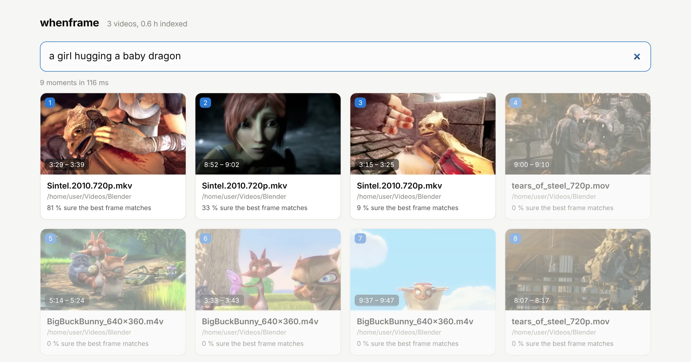

# Tutorial

## Install

whenframe needs Python 3.10 or later and ffmpeg.

```bash
# ffmpeg: apt install ffmpeg, brew install ffmpeg, or https://ffmpeg.org/download.html
pip install git+https://github.com/qthullie/whenframe
```

One extra is worth adding, to search what is said:

```bash
pip install "whenframe[speech] @ git+https://github.com/qthullie/whenframe"  # Whisper
```

OpenVINO encodes the frames, in bfloat16 on processors that compute in it
(recent Intel Xeon with AMX, AMD Zen 4 and later). On the DiDeMo test videos,
on the Xeon of the benchmark, SigLIP 2's encoding took 4.8 CPU minutes per hour
of video instead of 22.6 with ONNX Runtime, and the search found as many
moments ([RESULTS.md](RESULTS.md), third round). Other processors were not
measured. `--backend onnxruntime` runs SigLIP 2's image encoder with ONNX
Runtime; PE core B/16's runs with OpenVINO either way.

The first run downloads the models (about 2.6 GB: SigLIP 2 B/16 and PE core
B/16) into `~/.cache/whenframe` (or `$WHENFRAME_CACHE`), each file checked
against its SHA-256 where whenframe pins one; `--speech` downloads Whisper
(145 MB for base, 480 MB for small) the same way. Nothing else goes over the
network. whenframe turns off ONNX Runtime's usage telemetry
(`ORT_DISABLE_TELEMETRY=1`) and keeps OpenVINO's from loading (`import
openvino` otherwise reports to Google Analytics); every connection of an
indexing and a search run was traced to check it.

## Index a folder

```bash
whenframe index ~/Videos
```

Every video under the folder is read at one frame per second. Frames that
barely differ from the previous one are skipped. Run the same command again
later: only new or modified videos are indexed.

Photos in the folder (JPEG, PNG, WebP, TIFF, BMP, and HEIC or AVIF where ffmpeg
can read them) are indexed too, turned upright as their EXIF says, each as a
single frame: a search ranks them with the moments of the videos, and shows
them as photos. `--no-photos`, the first time a library is indexed, keeps it to
videos. A video's moment is judged on its best frame among about ten, a photo
on its only one, which can favour videos slightly; it was not measured.

Each frame is looked at by two image encoders, Google's SigLIP 2 B/16 and
Meta's PE core B/16, which learnt from different images and miss different
things. Each encoder's frames then go through whenframe's own model trained on
its frames (v3 and v4, below), and a search adds the two encoders' scores. On
the four test sets, this found the most of everything measured: 43.72 on the
mean of their primary metrics, more on each of them than SigLIP 2 B/16 with v3
alone (41.90, the default until the eleventh round) and than SigLIP 2 So400m
(40.63). Indexing costs about 9 CPU minutes per hour of video, each frame
decoded once for both encoders, and a search holds both text towers in memory
(at most 4.7 GB for a search of the demo's three films). The measured numbers
are in [RESULTS.md](RESULTS.md), "Eleventh round".

Libraries built by earlier versions, in their standard, economy, precision or
large modes, keep the models they were built with: they are searched and kept
up to date as before.

The index lives in `~/.local/share/whenframe/library` (or `$WHENFRAME_LIBRARY`,
or `--library DIR`). It takes about 11 MB per hour of video.
A search copies it into memory as float32, about 22 MB per hour of video, when
that fits in a quarter of the computer's memory (`WHENFRAME_MEMORY=2`, in
gigabytes, sets another limit); a larger library is read from its files a block
at a time, which the system caches as it can. On a simulated library of 300
hours, a search took 0.1 s with the copy and 0.3 s without it. The query bank's
correction of each frame is computed when the frame is indexed (0.07 ms a frame
here); a library indexed with an earlier version gets it at its next indexing
run or search, once.

```bash
whenframe stats      # what is indexed
whenframe compact    # reclaim space after videos were re-indexed or removed
```

### whenframe's own models

Each video's frames go through whenframe's own models before they are stored:
two transformer layers that add to each frame's embedding what the frames
around it show, v3 for SigLIP 2 B/16's frames and v4, the same recipe, for PE
core B/16's; both trained on the moments described in the training videos of
DiDeMo (with TEMPO-HL's sentences), MSR-VTT, Charades-STA and YouCook2. With
SigLIP 2 B/16 alone, v3 put the right moment among the first five of DiDeMo's
test 29.4 % of the time instead of 27.6 %, as often as SigLIP 2 So400m
(29.5 %; [RESULTS.md](RESULTS.md), "Seventh round"); with both encoders and
both models, 32.0 % ("Eleventh round"). Most of their gain on Charades-STA and
YouCook2 comes from their training videos: on videos unlike any they learnt
from, expect less (on UnAV-100, which v3 never saw, it finds 0.3 points fewer
than SigLIP 2 alone). Each costs about 0.03 CPU minutes per hour of video,
against some 7 for SigLIP 2's image tower. Photos keep their embeddings.

```bash
whenframe index ~/Videos --no-temporal   # the encoders' embeddings as they are, the first time a library is indexed
```

Their weights are for research and non-commercial use, as the videos they were
trained on (`whenframe/data/NOTICE`). Without them, the two encoders are
searched together all the same; that was not measured (each alone was:
SigLIP 2 B/16 38.07 on the mean of the four tests, PE core B/16 39.51; ninth
round). A library is built with them or without them: use a new folder to
change; a library indexed before they existed keeps its embeddings.

### What is said

```bash
whenframe index ~/Videos --speech base      # or small: slower, better transcripts
```

With `--speech`, every video is also transcribed by Whisper on the CPU, and a
search looks for its words in what is said as well as in the frames: "when she
says happy birthday" finds the moment even if nothing in the picture shows it.
The words that matched are shown with the moment. The library keeps the setting:
later runs transcribe new videos, and running it on a library indexed without it
transcribes the videos it already has. Whisper base took 8.1 minutes of CPU time
per hour of video on 252 YouCook2 cooking videos, where it raised the right step
among the first five moments from 12.3 % to 18.8 % ([RESULTS.md](RESULTS.md),
third round); the time depends on how much is said.

### What is heard

```bash
whenframe index ~/Videos --sounds
```

With `--sounds`, the sound track of every video is cut into 5-second windows
that overlap by half, and each is embedded by CLAP (LAION, Apache 2.0; a 0.8 GB
download at the first run). A search then adds what is heard around each frame
to what is seen: "a dog barking", "people laughing", "a fire truck siren".
Like `--speech`, the library keeps the setting, and running it on a library
indexed without it embeds the sound of the videos it already has. A moment
whose sound matches is shown with "heard: the sound matches", even when no
frame does (the frames' confidence then reads 0 %), as one with matching
speech is shown with the words said. It took 4.7
CPU minutes per hour of video with OpenVINO. On the clips of UnAV-100, it
raised the share of right moments among the first ten from 42.9 % to 53.2 %
([RESULTS.md](RESULTS.md), fourth round); it moves wrong moments up when CLAP
does not recognise the description in the sound, and it was not measured on
long home videos.

How much what is said and what is heard count was chosen with the models on
tuning videos: with both encoders, what is heard weighs 1.5 and what is said
counts up to 5 seconds around a frame. A library built by an earlier version
is searched with the settings chosen for its own models.

### Long moments

```bash
whenframe search --moments spans "add the onions to the pan"     # or windows; auto by default
whenframe serve --moments spans
```

A moment lasts 10 seconds around the frames that match best (windows), or as
long as the frames keep matching (spans). By default (`--moments auto`), a
library whose videos last more than a minute (its median video) gets spans, and
one of shorter clips gets windows: on DiDeMo's clips of at most 30 seconds,
windows did better; on the YouCook2 cooking videos of about 5 minutes, spans
put the right step among the first five moments 19.4 % of the time instead of
12.3 %, and 25.8 % with speech ([RESULTS.md](RESULTS.md), fourth round). A
library holding both kinds gets the kind of most of its videos.

## Keep the library up to date

```bash
whenframe watch ~/Videos                 # a pass every 5 minutes (--every SECONDS)
whenframe watch ~/Videos --once          # one pass, for cron or a systemd timer
whenframe serve --watch ~/Videos         # the search page, with the same passes in the background
```

Each pass indexes new and modified videos and forgets the ones that were
deleted. A file modified in the last minute (`--settle`) waits for the next
pass, so a video still being copied is not indexed half-written. If every
video indexed under a folder has disappeared at once, the folder is taken for
an unmounted disk or share and nothing is forgotten. A video that fails to
decode is tried again only once its file changes.

## Search

```bash
whenframe search "a dog jumps into the pool"
```

```
 83%     1:12 - 1:22      /home/me/Videos/2024/summer/IMG_4120.MOV
 71%     0:03 - 0:13      /home/me/Videos/2023/garden.mp4
 ...
```

Each line is a moment: how sure the model is that its best frame matches the
description, where the moment starts and ends, and the file. About a tenth of
the model's training text was not English, so descriptions in French or Spanish
can work; they were not measured here, and English is the safer bet.

## In the browser

```bash
whenframe serve            # then open http://127.0.0.1:8765
```

The model stays loaded, so each search answers in a fraction of a second. The
page shows the best frame of each moment; a click plays the video from the start
of the moment and stops at its end. It listens on this computer only (`--host`
changes that) and loads nothing from the internet. Browsers play mp4 and webm;
for other formats the page gives the file's folder, to open it in a video
player.

<p align="center">
  <picture>
    <source media="(prefers-color-scheme: dark)" srcset="figures/demo-2-dark.webp">
    
  </picture>
</p>

## Next to Jellyfin

If the videos are also in a Jellyfin server, `serve` can link each moment to the
video's page there:

```bash
export JELLYFIN_API_KEY=...       # Jellyfin: Dashboard, API Keys
whenframe serve --host 0.0.0.0 --watch /srv/videos \
    --jellyfin http://192.168.1.10:8096 --jellyfin-path /srv/videos=/media
```

`--jellyfin` is the address you open Jellyfin with in your browser; whenframe
must reach it too. When Jellyfin runs in a container, it usually sees the
videos under another path: `--jellyfin-path HERE=THERE` says that a file
whenframe sees in HERE is in THERE for Jellyfin. The player of the search page
then shows "Open in Jellyfin". Jellyfin's web client has no address for a time
inside a video, so the link opens the video's page; whenframe's own player
plays the moment. Tested against Jellyfin 10.11.3, run in Docker with its
library on the same folder.

## Next to Immich

If the videos and photos are also in an Immich server (uploaded, or in an
external library), `serve` can link each moment to its page there:

```bash
export IMMICH_API_KEY=...         # Immich: Account Settings, API Keys (asset.read)
whenframe serve --host 0.0.0.0 --watch /srv/photos \
    --immich http://192.168.1.10:2283 --immich-path /srv/photos=/mnt/media
```

`--immich-path HERE=THERE` works as for Jellyfin: Immich in its container
usually sees the files under another path. Immich finds them by that path;
the player of the search page then shows "Open in Immich", which opens the
video or photo in Immich's viewer. Written from Immich's API documentation
(version 1.140) and tested against a stand-in server, not against a running
Immich.

## In a container

```bash
docker build -t whenframe https://github.com/qthullie/whenframe.git
docker run -d --name whenframe -p 8765:8765 \
    -v /srv/videos:/videos:ro -v whenframe:/data whenframe
```

The container serves the search page on port 8765 and keeps the index of
`/videos` up to date (`serve --host 0.0.0.0 --watch /videos`); the index and the
downloaded models live in the `/data` volume. CI
builds the image and starts the tool in it; indexing inside the container was
not tested.

## From Python

```python
from whenframe import Library, Searcher

lib = Library("my-library")
lib.add("holiday.mp4")
for hit in Searcher(lib).search("sunset over the sea", k=5):
    print(hit.path, hit.start, hit.end, hit.confidence)
```

Each `whenframe search` loads the text models first, which takes a few seconds;
from Python, keep one `Searcher` and the following searches take tens of
milliseconds.

`SearchConfig` holds the few settings of the search: fixed windows or spans
grown around peaks, the window length, how many moments per video, and the
weight of the query-bank correction (0 turns it off). The defaults are the ones
chosen on DiDeMo training videos.

## How it works

1. ffmpeg reads one frame per second; frames that barely differ from the last
   one kept are skipped.
2. [SigLIP 2](https://arxiv.org/abs/2502.14786) B/16 and
   [PE core B/16](https://arxiv.org/abs/2504.13181) each embed the frames and
   the description (OpenVINO, CPU). SigLIP's sigmoid gives each frame an
   absolute match score, so frames from different videos compare directly.
   Then a small transformer of whenframe's own for each encoder (v3 and v4),
   trained on the training videos of DiDeMo, MSR-VTT, Charades-STA and
   YouCook2, rewrites each frame's embedding with what the frames around it
   show (in the spirit of [CLIP4Clip](https://arxiv.org/abs/2104.08860)'s
   temporal transformer), for about 0.03 CPU minutes per hour of video each.
3. Frames that match almost any description are marked down, for each encoder
   with a bank of 4,096 unrelated descriptions: query-bank normalisation
   ([Bogolin et al., CVPR 2022](https://arxiv.org/abs/2112.12777)), applied to
   video frames.
4. With `--speech`, the words of the description said around a frame add to
   its score (Whisper and a full-text index); with `--sounds`, so does what is
   heard around it ([CLAP](https://arxiv.org/abs/2211.06687), standardised and
   added). Both count as chosen with the models on the tuning sets.
5. The two encoders' scores are standardised over the library, added (PE's
   with weight 0.75) and put back on SigLIP 2's scale. In each of the best
   videos, up to three 10-second moments are placed around the best frames,
   and all moments are ranked together.

## Reproduce the benchmark

The evaluation uses DiDeMo (Hendricks et al., 2017). The annotations and an
mp4 copy of the videos are on the Hugging Face Hub
(`friedrichor/DiDeMo`: `raw_data/didemo_{train,test}.json`,
`DiDeMo_Videos_mp4_test.tar`, `DiDeMo_Videos_mp4_train.tar.part-000`). Put them
under `data/didemo/` as:

```
data/didemo/didemo_train.json
data/didemo/didemo_test.json
data/didemo/train/   *.mp4 from the first part of the training archive
data/didemo/test/    *.mp4 from the test archive
```

then:

```bash
make didemo-extract   # frame and text embeddings, scene cuts, timings
make didemo-tune      # parameters of every method, on training videos only
make didemo-eval      # the test numbers in docs/RESULTS.md
make tables           # rewrite the tables from results/*.json
```

The second round needs the English-to-French model as well
(`Xenova/opus-mt-en-fr` on the Hugging Face Hub: `config.json`,
`tokenizer.json`, `onnx/encoder_model.onnx`, `onnx/decoder_model.onnx`, in
`data/opus-mt-en-fr/`); MobileCLIP-S2 is downloaded like SigLIP 2:

```bash
make didemo-explore   # the other score corrections tried on tuning videos
make didemo-round2    # MobileCLIP-S2, French descriptions, calibration, tuning, test
make tables
```

The third round embeds the DiDeMo videos again with OpenVINO (`make
didemo-round3`, after `make didemo-extract`) and adds YouCook2: the annotations
are `data/val-00000-of-00001.parquet` of `lmms-eval/YouCook2`, as
`data/youcook2/val.parquet`, and the videos are the `videos/ID.mp4` files of
`nguyenminh04/youcook2-videos` that it names, in `data/youcook2/videos/` (252
were there). `make youcook2` embeds and transcribes them, tunes the weight of
speech on a third of the videos and evaluates on the others; it needs both
extras (`pip install -e ".[dev,fast,speech]"`).

The fourth round (`make round4`, after the third) adds speech to the adaptive
spans on YouCook2, embeds the DiDeMo videos again with SigLIP 2 So400m
(Immich's ONNX export, 4.3 GB, downloaded at the first run), and measures what
is heard on UnAV-100: `unav100_all.json` of `nguyenminh04/unav100-videos` on
the Hugging Face Hub, as `data/unav/unav100_all.json`; the 22 archives of
videos (25 GB) are read as they download, one video at a time, and nothing of
them is kept but the embeddings. UnAV-100 is licensed for non-commercial
research (CC BY-NC-SA 4.0). `make benchmark-figure` draws
[figures/benchmark.png](figures/benchmark.png) from the results.

The sixth round (`make round6`, after the fifth) reads MSR-VTT's training
archive on the Hub by byte ranges (`msrvtt_train_9k.json` of
`friedrichor/MSR-VTT` in `data/msrvtt/`), trains model v2, embeds the four
benchmarks' frames again with So400m and B/32, measures every encoder's cost
the same way and tests the five candidates once.

The seventh round (`make round7`, after the sixth) embeds the frames of
Charades-STA's training videos (the full Charades archive of
`lmms-eval/charades_sta` on the Hub) and YouCook2's
(`nguyenminh04/youcook2-videos`), read by byte ranges one video at a time and
none kept, and the training descriptions of Charades-STA, YouCook2 and
TEMPO-HL (`charades_sta_train.txt`, `youcookii_train.jsonl` and
`tempoHL+didemo_train.json` in `data/train-annotations/`). `scripts/round7.py`
then trains model v3 and makes the choices on the tuning sets by the rule
(about eight hours on four cores), and the test runs once.

The fifth round (`make round5`, after the others; `pip install -e ".[train]"`
for JAX) trains whenframe's own model. It reads DiDeMo's training archive
(`DiDeMo_Videos_mp4_train.tar.part-000` to `-007`, 43 GB) as it downloads, one
video at a time, keeps only the embeddings of their frames, and resumes where
it stopped; then it embeds the training descriptions, trains the model with
the settings chosen on the tuning videos (on four cores: about an hour),
exports it to `whenframe/data/` and runs the test once.

Charades-STA comes from the `lmms-eval/charades_sta` copy on the Hugging Face
Hub: `data/test-00000-of-00001.parquet` as `data/charades/test.parquet`, and,
from the four `Charades_v1_480_part_N.zip` archives (16 GB), the 1,334 videos
it names, in `data/charades/videos/`. Charades is licensed for non-commercial
research. `make charades` embeds the videos and runs the methods with the
parameters tuned on DiDeMo (pyarrow, in the dev extras, reads the annotations).

The protocol, including the success criteria, is in [PROTOCOL.md](PROTOCOL.md).
